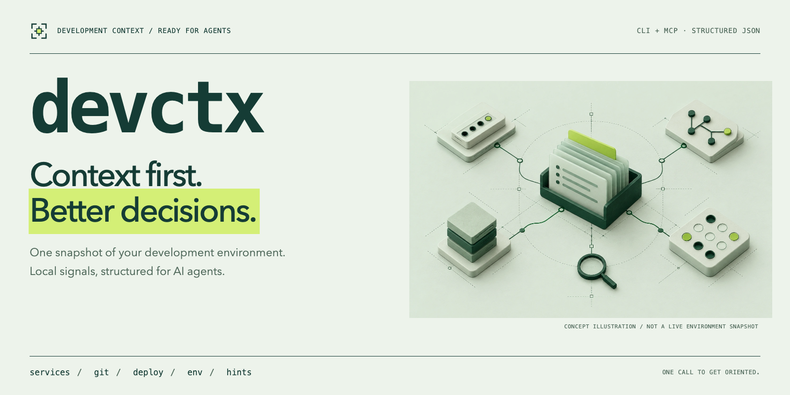
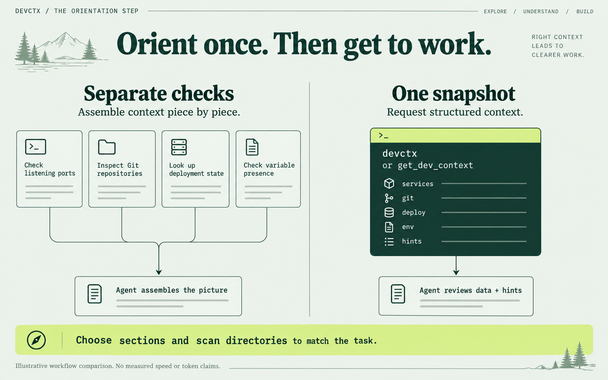
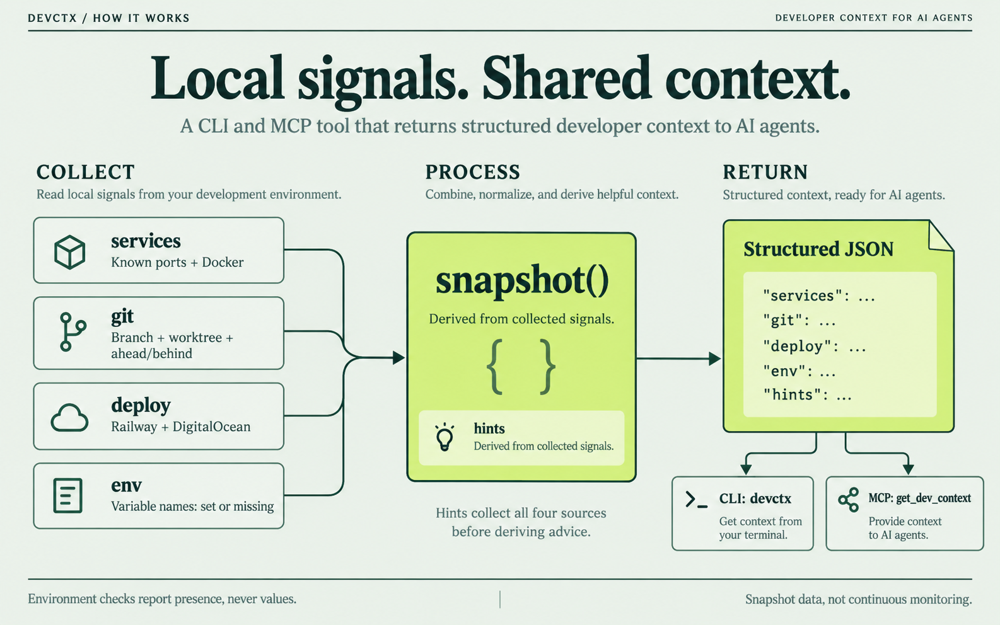

# devctx

<p align="center">
  
</p>

<!-- Rendered from docs/banner.html at 1600x800. See docs/BRAND.md. -->

**Context first. Better decisions.**

`devctx` gives AI agents a structured snapshot of development signals: known
services, Git state, deployment context, environment-variable presence, and
derived hints. Use the CLI in a terminal or call `get_dev_context` from an
MCP-compatible agent.

[Install](#install) · [How it works](#how-it-works) · [Usage](#usage) · [Architecture](#architecture) · [Scope and privacy](#scope-and-privacy) · [MIT license](LICENSE)

```bash
devctx --git --hints --scan-dir .
```

Choose the sections and scan directories that fit the task. A snapshot helps an
agent get oriented; it does not replace task-specific investigation.

## Why

Checking ports, inspecting repositories, finding deployment context, and checking
variable presence are separate discovery steps. `devctx` packages those signals
into one JSON response, with hints an agent can review before acting.

<p align="center">
  
</p>

| Need | What devctx returns |
|---|---|
| Understand local services | Known listening ports and Docker container information |
| Check repository state | Branch, dirty state, ahead/behind counts, and recent commit information |
| Find deployment context | Railway project context and DigitalOcean droplets, when available |
| Check configuration presence | Names of expected variables that are set or missing, never their values |
| Decide what to inspect next | Prioritized hints derived from collected signals |

No fixed token count, speedup, or retry reduction is claimed. Output size and
usefulness depend on the scan scope, available tools, and local environment.

## Install

Requires **Python 3.10+**.

```bash
pip install devctx
```

Or install from source:

```bash
git clone https://github.com/DevvGwardo/devctx.git
cd devctx
pip install .
```

## How it works

1. **Choose a scope.** Select sections and Git scan directories through CLI flags or MCP arguments.
2. **Collect signals.** The tool checks the requested sources. When hints are requested, it collects all four source sections so the hints have data to work from.
3. **Derive hints.** Heuristics highlight conditions such as unpushed commits or missing expected variables.
4. **Return JSON.** The CLI or MCP tool returns the requested fields, plus version and timestamp metadata.

The data is a point-in-time snapshot, not a continuously updated monitor.

### What an agent receives

An abbreviated example with fictitious project data:

```json
{
  "services": {
    "ports": {
      "postgres": { "port": 5432, "status": "listening", "label": "postgres" },
      "hermes-gateway": { "port": 8642, "status": "listening", "label": "hermes-gateway" }
    }
  },
  "git": {
    "demo-app": {
      "branch": "main",
      "dirty": true,
      "ahead": 0,
      "behind": 0,
      "changed_files": 2
    }
  },
  "deploy": {},
  "env": {
    "set": ["GITHUB_TOKEN"],
    "missing": ["OPENAI_API_KEY"]
  },
  "hints": [
    "demo-app has 2 uncommitted change(s)",
    "missing env vars: OPENAI_API_KEY"
  ]
}
```

Service detection covers configured known ports, not every possible service.
Deployment context depends on local configuration and installed CLI tools.
Hints are heuristics: review them against the needs of your project.

## Usage

### CLI

```bash
# All sections
devctx

# Specific sections; combine flags as needed
devctx --services          # Known listening services and Docker containers
devctx --git               # Git state across the chosen scan directories
devctx --deploy            # Railway and DigitalOcean context
devctx --env               # Expected variable names: set or missing
devctx --hints             # Return hints; all source collectors still run

# Scope and output
devctx --git --hints --scan-dir .
devctx --scan-dir ~/projects --scan-dir ~/work
devctx --env --check-env MY_CUSTOM_VAR
devctx --compact
```

With no explicit scan directory, Git discovery uses the current repository root
if it can find one, otherwise your home directory. Pass `--scan-dir` explicitly
when you want a narrower or different scope.

### MCP server

The built-in stdio MCP server exposes one tool, `get_dev_context`, backed by the
same snapshot function as the CLI.

**Claude Code:**

```bash
claude mcp add devctx -- devctx-mcp
```

**Hermes (`~/.hermes/config.yaml`):**

```yaml
mcp_servers:
  devctx:
    command: devctx-mcp
```

Example tool arguments:

```json
{
  "sections": ["git", "hints"],
  "scan_dirs": ["."]
}
```

Relative paths resolve from the MCP server process's working directory. Use an
absolute project path when that directory is uncertain.

The MCP server sees the environment inherited from its launcher. Variables
exported in an interactive terminal may not reach an agent started from a GUI
or service. Configure required variables securely in that host or client
environment. The `env` collector returns variable names and presence, not values.

### In agent prompts

Add a scoped instruction to your agent guidance:

```text
For work that depends on the development environment, request devctx context
with explicit scan directories and the sections relevant to the task.
Review the hints before acting, and verify task-specific assumptions.
```

## Architecture

<p align="center">
  
</p>

| Collector | What it checks | How |
|---|---|---|
| **services** | Known listening ports and Docker containers | Socket probes, `lsof`, `docker ps` |
| **git** | Branch, dirty state, ahead/behind counts, recent commit | Git CLI across scanned directories |
| **deploy** | Railway projects and DigitalOcean droplets | Local configuration and CLI tools |
| **env** | Presence of expected variables | `os.environ`; values are not returned |
| **hints** | Conditions derived from collected signals | Aggregation and heuristics |

When hints are requested, all source collectors run even if their sections are
omitted from the response. The returned fields still follow the requested scope.

### Adding collectors

Add a file in `devctx/collectors/`, implement a `collect_*()` function that
returns a dictionary, and wire it into `devctx/cli.py:snapshot()`.

## Scope and privacy

- **Point in time.** Request a fresh snapshot when relevant state changes.
- **Deliberate scope.** Select Git scan directories and output sections to match the task.
- **Presence, not values.** The environment collector reports variable names only.
- **Review before sharing.** Other fields can contain repository names, commit messages, local paths, deployment metadata, and network addresses.
- **Hints, not guarantees.** Collected signals are limited by permissions, installed tools, supported providers, and the known-port list.

The diagrams and hero image are AI-generated conceptual illustrations. They do
not contain captured machine state or measured performance results.

## Testing

```bash
python3 -m pytest tests/ -q
```

## Credits and visual assets

Built by [DevvGwardo](https://github.com/DevvGwardo). Inspired by
[InsForge's context-engineering approach](https://github.com/InsForge/InsForge).

See the [brand guide](docs/BRAND.md) for editable sources and image provenance.
Open `docs/brand.html` locally for the responsive visual guide.

## License

[MIT](LICENSE).
